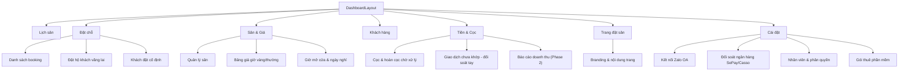

# 03 — Giao diện app quản lý (chủ sân)

Đặc tả giao diện app quản lý dành cho **chủ sân** — dựng bằng **Laravel + Inertia + React + shadcn/ui** (theo khuôn mẫu appdhv: mỗi màn hình là một Inertia Page render từ Controller, bọc trong `Layouts/DashboardLayout`, scope theo `WorkingTenant`). **Mobile-first** vì chủ sân chủ yếu thao tác trên điện thoại ngay tại quầy.

Xem thêm: sản phẩm & mặt tiền ba lớp [`01-san-pham.md`](01-san-pham.md), yêu cầu chức năng [`02-yeu-cau-chuc-nang.md`](02-yeu-cau-chuc-nang.md), cấu hình trang [`04-cau-hinh-per-tenant.md`](04-cau-hinh-per-tenant.md), luồng đặt/cọc [`07-luong-du-lieu.md`](07-luong-du-lieu.md), thiết kế module [`08-thiet-ke-module-chi-tiet.md`](08-thiet-ke-module-chi-tiet.md).

---

## 1. Sơ đồ điều hướng (IA)

**Bottom nav (mobile)** rút gọn còn 5 mục hay dùng nhất: **Lịch · Đặt chỗ · Cọc · Khách · Cài đặt**. Các mục sâu hơn nằm trong từng nhóm.

---

## 2. Screen inventory

> Cột "Component" ghi shadcn/ui cụ thể. "Page/Controller" theo quy ước Inertia của appdhv.

### 2.1 Lịch sân (màn hình chính)

| Khía cạnh | Chi tiết |
|---|---|
| **Mục đích** | Xem toàn cảnh đặt chỗ trong ngày/tuần; điểm khởi đầu mọi thao tác |
| **Component** | Lưới tự dựng (CSS grid) trục ngang = sân, dọc = khung giờ; `Tabs` (Ngày/Tuần), `Popover` chi tiết ô, `Sheet` mở nhanh đặt hộ, `Badge` màu trạng thái, `Select` chọn ngày, `Button` icon `lucide-react` |
| **Chọn renderer** | Lưới sân×giờ này là renderer **`CourtGrid`** — được chọn từ component registry theo `tenant.vertical` (`racket_court` → `CourtGrid`; golf → `TeeSheet`). Controller truyền prop `ui`. Xem [`08-thiet-ke-module-chi-tiet.md`](08-thiet-ke-module-chi-tiet.md) §0 |
| **Dữ liệu** | Các `booking_slot` của ngày theo `WorkingTenant`; mỗi ô: tên khách, trạng thái cọc, cờ đặt cố định, cờ bom |
| **Trạng thái ô** | ⬜ Trống · 🟡 Giữ tạm (đang chờ cọc, có đồng hồ đếm ngược) · 🟢 Đã cọc/confirmed · 🔵 Khách cố định · 🔴 Bom (no-show) · ⬛ Đóng/bảo trì |
| **Hành động** | Bấm ô trống → `Sheet` đặt hộ · Bấm ô đã đặt → `Popover` (xem khách, gọi điện, đánh dấu bom, hủy) · Kéo đổi ngày |
| **Rỗng/Lỗi** | Ngày chưa có đặt: lưới trống + gợi ý "Chia sẻ link đặt sân". Lỗi tải: banner `Alert` + nút thử lại |
| **Page/Controller** | `Pages/Manager/Calendar/Index` ← `Manager\CalendarController@index` |

### 2.2 Danh sách + chi tiết booking

| Khía cạnh | Chi tiết |
|---|---|
| **Mục đích** | Tra cứu, lọc, xử lý từng booking |
| **Component** | `Table` (sortable), `Input` tìm kiếm, `Select`/`DropdownMenu` bộ lọc (trạng thái, sân, khoảng ngày), `Dialog` chi tiết, `Pagination` |
| **Dữ liệu** | `bookings` scope tenant: mã (SAN-xxxx), khách, sân, giờ, trạng thái, cọc, kênh (zalo/owner_manual) |
| **Hành động** | Mở chi tiết → xác nhận thủ công / hủy (`AlertDialog`) / đánh dấu bom / hoàn cọc. *(Reschedule đổi giờ/sân là FR-B9 — Phase 2, chưa có UI ở Phase 1.)* |
| **Rỗng/Lỗi** | "Chưa có lượt đặt nào khớp bộ lọc" |
| **Page/Controller** | `Pages/Manager/Bookings/Index` ← `Manager\BookingController@index` |

### 2.3 Đặt hộ khách vãng lai (tiền mặt)

| Khía cạnh | Chi tiết |
|---|---|
| **Mục đích** | Khách gọi điện/tới trực tiếp → chủ sân đặt tay |
| **Component** | `Sheet`/`Dialog` form: `Select` sân, `Calendar`+`Select` giờ, `Input` tên/SĐT khách, `RadioGroup` (tiền mặt / gửi QR cọc) |
| **Dữ liệu** | Availability sân theo giờ (gọi `AvailabilityService`), giá tự hiện |
| **Hành động** | "Giữ chỗ" → `payment_mode=cash`, bỏ qua QR, confirmed ngay; hoặc "Gửi QR cọc" → tạo hold + hiện QR |
| **Rỗng/Lỗi** | Giờ trùng → `Alert` "Sân đã có người giữ giờ này" (bắt lỗi 409 từ exclusion constraint) |
| **Page/Controller** | Modal trong Calendar; submit → `Public\BookingController@storeManual` (owner-only) |

### 2.4 Khách đặt cố định (series)

| Khía cạnh | Chi tiết |
|---|---|
| **Mục đích** | Quản lý khách ruột giữ khung giờ hàng tuần |
| **Component** | `Table` series, `Progress` (đã dùng X/Y buổi), `Dialog` tạo series (`Select` thứ/giờ/sân, `Calendar` khoảng ngày), `AlertDialog` hủy |
| **Dữ liệu** | `recurring_series`: khách, sân, thứ+giờ, còn mấy buổi, đã thu tiền tới đâu, buổi vướng lịch |
| **Hành động** | Tạo series (hiện `conflicts` để xử tay) · **Hủy 1 buổi** (series vẫn chạy) · Kết thúc series |
| **Rỗng/Lỗi** | "Chưa có khách cố định". Tạo series bị vướng → liệt kê buổi trùng, gợi đổi sân/giờ |
| **Page/Controller** | `Pages/Manager/Series/Index` ← `Manager\SeriesController@index`; xem [`07-luong-du-lieu.md`](07-luong-du-lieu.md) luồng (b) |

### 2.5 Quản lý sân

| Khía cạnh | Chi tiết |
|---|---|
| **Mục đích** | CRUD sân, đánh dấu bảo trì |
| **Component** | `Table`/`Card` grid, `Dialog` form (tên, loại `Select` cầu lông/pickleball), `Switch` trạng thái, `AlertDialog` archive |
| **Dữ liệu** | `courts` scope tenant |
| **Hành động** | Thêm/sửa · Đặt bảo trì · **Archive** (soft-delete, giữ booking cũ — điểm vỡ #12) |
| **Rỗng/Lỗi** | "Chưa có sân nào — thêm sân đầu tiên" (onboarding) |
| **Page/Controller** | `Pages/Manager/Courts/Index` ← `Manager\CourtController@index` |

### 2.6 Bảng giá giờ vàng/thường

| Khía cạnh | Chi tiết |
|---|---|
| **Mục đích** | Đặt luật giá theo thứ + khoảng giờ |
| **Component** | `Table` luật giá + `Dialog` editor (`ToggleGroup` chọn thứ, `Input` giờ bắt đầu/kết thúc, `Input` giá/giờ, `Input` priority), lưới xem trước giá theo giờ |
| **Dữ liệu** | `pricing_rule` (luật cụ thể priority cao đè luật chung) |
| **Hành động** | Thêm/sửa/xóa luật · Xem trước bảng giá tuần |
| **Rỗng/Lỗi** | Bắt buộc có ít nhất 1 luật giá chung trước khi bật nhận đặt |
| **Page/Controller** | `Pages/Manager/Pricing/Index` ← `Manager\PricingRuleController@index` |

### 2.7 Giờ mở cửa & ngày nghỉ

| Khía cạnh | Chi tiết |
|---|---|
| **Mục đích** | Khung giờ nhận đặt + chặn ngày lễ/bảo trì |
| **Component** | `Table` theo thứ (`TimePicker`/`Input` giờ mở–đóng), `Calendar` chọn ngày blackout, `Dialog` thêm blackout |
| **Dữ liệu** | `opening_rule` (versioned `effective_from/to`), `blackout` |
| **Hành động** | Sửa giờ mở (đóng rule cũ, mở rule mới — điểm vỡ #4) · Thêm ngày nghỉ (cả cơ sở hoặc 1 sân) |
| **Rỗng/Lỗi** | Cảnh báo nếu đổi giờ khiến booking đã có nằm ngoài lịch mới |
| **Page/Controller** | `Pages/Manager/OpeningHours/Index` ← `Manager\OpeningRuleController@index` |

### 2.8 Khách hàng (CRM nhẹ)

| Khía cạnh | Chi tiết |
|---|---|
| **Mục đích** | Hồ sơ khách, lịch sử, cờ hay bom |
| **Component** | `Table` + `Input` tìm theo SĐT, `Dialog`/`Drawer` hồ sơ (lịch sử booking, tỉ lệ bom), `Badge` "Hay bom" |
| **Dữ liệu** | `customers` scope tenant + thống kê từ `bookings` |
| **Hành động** | Xem lịch sử · Đánh dấu/bỏ cờ hay bom · Gọi/nhắn Zalo |
| **Rỗng/Lỗi** | "Chưa có khách — khách tự tạo khi đặt sân" |
| **Page/Controller** | `Pages/Manager/Customers/Index` ← `Manager\CustomerController@index` |

### 2.9 Cọc & hoàn cọc chờ xử lý

| Khía cạnh | Chi tiết |
|---|---|
| **Mục đích** | Danh sách việc tiền cần chủ sân xử tay (hoàn cọc, cọc mồ côi) |
| **Component** | `Table` với cột **tuổi việc** (badge đỏ dần theo ngày), `Dialog` xác nhận "Đã chuyển khoản trả" |
| **Dữ liệu** | `refunds` status `requested`; `payments` status `orphaned` |
| **Hành động** | "Đã CK trả" → refund `done` + gửi Zalo báo khách · Xem chi tiết giao dịch |
| **Rỗng/Lỗi** | "Không có việc tiền nào chờ" (trạng thái tốt) |
| **Page/Controller** | `Pages/Manager/Refunds/Index` ← `Manager\RefundController@index` |

### 2.9b Giao dịch ngân hàng chưa khớp (đối soát tay)

| Khía cạnh | Chi tiết |
|---|---|
| **Mục đích** | Xử tay các giao dịch chuyển khoản KHÔNG tự khớp được booking (thiếu/dư tiền, sai/thiếu nội dung) — [`02`](02-yeu-cau-chuc-nang.md) FR-C8; [`10`](10-tinh-huong-phat-sinh.md) P1/P2/P3/P6/P8 |
| **Component** | `Table` giao dịch từ `bank_txn_inbox` chưa khớp (số tiền, nội dung, thời gian, ngân hàng), `Dialog` gán vào booking (tìm theo mã/khách/giờ) |
| **Dữ liệu** | `bank_txn_inbox` `processed_at IS NULL` / không khớp booking, scope tenant |
| **Hành động** | Gán giao dịch vào một booking (confirm tay) · Đánh dấu bỏ qua/không liên quan · Ghi chú xử lý phần thiếu/dư |
| **Rỗng/Lỗi** | "Không có giao dịch chờ khớp" (trạng thái tốt) |
| **Page/Controller** | `Pages/Manager/Payments/Unmatched` ← `Manager\ReconcileController@unmatched`; xem [`07-luong-du-lieu.md`](07-luong-du-lieu.md) luồng (a) |

### 2.10 Cấu hình trang đặt sân (branding)

| Khía cạnh | Chi tiết |
|---|---|
| **Mục đích** | Tùy biến trang đặt sân công khai (logo, màu, ảnh, mô tả) — trong khuôn khổ template |
| **Component** | Form 2 cột: bên trái `Input`/`Textarea`/`Input file`/color picker; bên phải **preview trực tiếp** (iframe/`Card`) |
| **Chi tiết** | Xem đầy đủ ở [`04-cau-hinh-per-tenant.md`](04-cau-hinh-per-tenant.md) |
| **Page/Controller** | `Pages/Manager/Site/Edit` ← `Manager\SiteController@edit` |

### 2.11 Cài đặt — Kết nối

| Màn hình | Component & nội dung |
|---|---|
| **Zalo OA** | `Card` trạng thái kết nối, `Button` nối OA, `Input` token; test gửi ZNS. `Pages/Manager/Settings/Zalo` |
| **Đối soát ngân hàng** | Chọn `Tabs` SePay/Casso, `Input` khóa webhook, hiển thị số TK nhận cọc, nút test đối soát. `Pages/Manager/Settings/Bank` |
| **Nhân viên & phân quyền** | `Table` nhân viên, `Dialog` mời (email + role owner/staff qua spatie), thu hồi quyền. `Pages/Manager/Staff/Index` |
| **Gói thuê phần mềm** | `Card` gói hiện tại + hạn dùng, lịch sử `invoice`. `Pages/Manager/Settings/Billing` (Phase 2) |

### 2.12 Báo cáo doanh thu (Phase 2)

| Khía cạnh | Chi tiết |
|---|---|
| **Mục đích** | Doanh thu theo sân / giờ vàng / khoảng thời gian |
| **Component** | `Card` KPI (tổng thu, tỉ lệ lấp đầy, tỉ lệ bom), biểu đồ (area/bar), `Select` khoảng ngày |
| **Page/Controller** | `Pages/Manager/Reports/Index` ← `Manager\ReportController@index` |

---

## 3. Nguyên tắc UX

- **Mobile-first, thao tác nhanh giờ cao điểm:** màn Lịch mở là thấy ngay; đặt hộ khách trong ≤3 chạm; nút to, vùng chạm rộng.
- **Trạng thái đọc bằng màu + nhãn** (không chỉ màu) để phân biệt trống/cọc/cố định/bom trong 1 liếc.
- **Flash message** (`flash.success`/`flash.error` share qua `HandleInertiaRequests`) sau mọi hành động ghi — toast ngắn, câu chủ động ("Đã giữ sân", "Đã hoàn cọc").
- **Xác nhận hành động nguy hiểm** (hủy booking, hoàn cọc, archive sân) bằng `AlertDialog`, không bao giờ 1-chạm-mất-dữ-liệu.
- **Đồng hồ đếm ngược** trên ô "giữ tạm" để chủ sân biết chỗ sắp tự nhả.
- **Offline nhẹ nhàng:** mất mạng → banner nhắc, không mất dữ liệu đang nhập.

---

## 4. Trang đặt sân công khai (mặt tiền khách chơi)

Không thuộc app quản lý nhưng chủ sân cấu hình nó. Màn hình khách chơi thấy (mobile-first, Inertia Page công khai `Pages/Public/Booking`):

1. **Chọn ngày** (`Calendar`) → **chọn khung giờ** → hiện **các sân còn trống + giá** (giờ vàng/thường tự đúng).
2. Chọn sân → nhập tên/SĐT → thấy **tiền cọc** → **QR VietQR** (nội dung = mã đặt).
3. Sau khi đối soát khớp → màn "Đã giữ sân" + thông tin; đồng thời nhận Zalo ZNS.

Luồng dữ liệu chi tiết (giữ tạm → đối soát → 3 nhánh) ở [`07-luong-du-lieu.md`](07-luong-du-lieu.md) luồng (a). Branding của trang này lấy từ [`04-cau-hinh-per-tenant.md`](04-cau-hinh-per-tenant.md).
