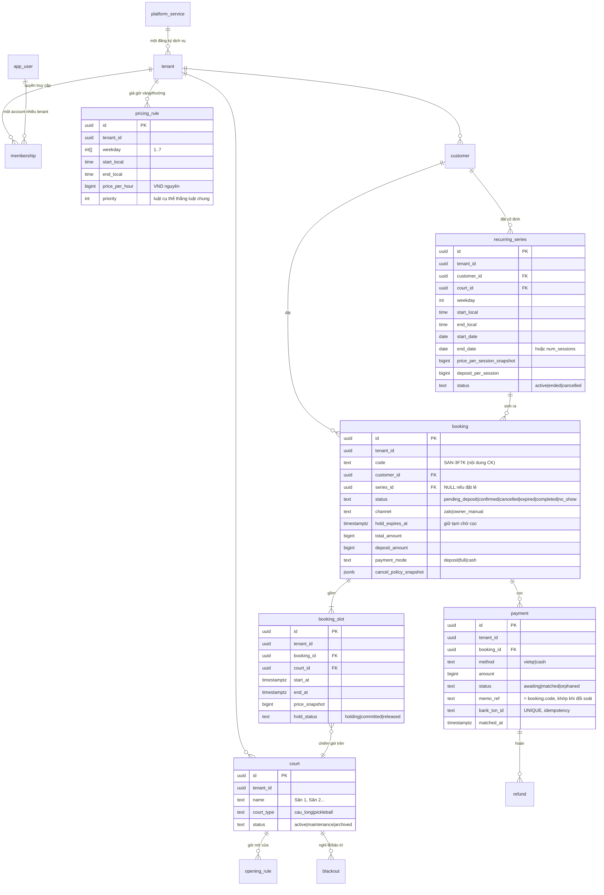

# 06 — ERD & Liên kết dữ liệu

## Multi-tenant (theo pattern `WorkingSchool` của appdhv)

**1 database, 1 schema, cột `tenant_id` (bigint FK) mọi bảng nghiệp vụ.** Một tenant = một cơ sở của đúng một dịch vụ đã đăng ký. Một account có thể có nhiều `memberships`, nhưng mỗi lần đăng ký dịch vụ tạo tenant riêng; không bật nhiều dịch vụ tùy ý trong cùng tenant.

1. **App-level scoping (lớp chính):** `App\Support\WorkingTenant::id($request)` là **nguồn duy nhất** quyết định request thuộc cơ sở nào. Non-operator chỉ được chọn tenant active có trong `memberships`; `users.tenant_id` là primary/fallback tương thích. Query/cookie forge ngoài membership bị bỏ qua. Mọi query controller `->where('tenant_id', WorkingTenant::id($request))`.
2. **Composite FK `(tenant_id, id)`** — bảng cha khai `UNIQUE(tenant_id, id)`, bảng con FK ghép, chống một dòng trỏ sang tenant khác kể cả khi code có bug.
3. **Postgres RLS (lưới an toàn tùy chọn, cứng hơn appdhv):** bật policy `USING (tenant_id = current_setting('app.tenant_id')::bigint)` set trong middleware — khuyến nghị bật để phòng lỗi quên `where`.

**Quy ước khóa (theo appdhv):** mỗi bảng có `id` **bigint PK** (nội bộ) + cột **`uuid`** cho route binding công khai (`getRouteKeyName(): 'uuid'`, không lộ id chạy số trên URL). Riêng `bookings` thêm `code` đọc được (SAN-3F7K) làm nội dung chuyển khoản. Model `use SoftDeletes` + `use Concerns\Auditable`. Mọi index dẫn đầu bằng `tenant_id`.

> ERD dưới đây vẽ khóa dạng khái niệm; khi hiện thực, PK là `id` bigint + `uuid` như trên.

**Tên bảng khi hiện thực là SỐ NHIỀU (chuẩn Laravel):** `platform_services, tenants, users, memberships, courts, resource_categories, opening_rules, blackouts, pricing_rules, customers, bookings, booking_slots, recurring_series, payments, bank_txn_inbox, refunds, tenant_bank_config, audit_logs`.

### Catalog dịch vụ và quyền truy cập

- `platform_services` là catalog cấp nền tảng do operator cấu hình bằng seeder/backend: tên thương mại, `vertical_key`, trạng thái mở đăng ký, pricing model, giới hạn resource, feature flags và trial.
- `tenants.service_id NOT NULL`: một tenant chỉ thuộc một dịch vụ. `tenants.vertical` là snapshot dispatch (`racket_court`, sau này `golf`...), lấy server-side từ service lúc đăng ký.
- `memberships(user_id, tenant_id, role)` là nguồn quyền multi-tenant. UNIQUE `(user_id, tenant_id)`; một account đăng ký thêm dịch vụ bằng cách tạo thêm tenant + membership.
- `users.tenant_id` tiếp tục là primary tenant để tương thích code cũ, không cấp quyền tới tenant ngoài membership.
- `resource_categories` là catalog tài nguyên riêng của từng tenant; nó không phải catalog dịch vụ nền tảng.

## Mô hình cốt lõi

Sân = **tài nguyên bị chiếm dụng theo khung giờ**. Không materialize lưới slot; chống chồng lịch bằng **exclusion constraint** trên `booking_slots`. Đặt cố định = một `recurring_series` sinh ra nhiều `bookings` + `booking_slots` đi qua đúng cơ chế đó.



## DDL — các ràng buộc mang bất biến nghiệp vụ

### Sân, giờ mở, giá

```sql
CREATE TABLE courts (
  id uuid DEFAULT gen_random_uuid(),
  tenant_id uuid NOT NULL,
  name text NOT NULL,
  court_type text NOT NULL CHECK (court_type IN ('cau_long','pickleball','khac')),
  status text NOT NULL DEFAULT 'active' CHECK (status IN ('active','maintenance','archived')),
  PRIMARY KEY (id),
  UNIQUE (tenant_id, id)                 -- cho composite FK
);

-- Giờ mở cửa theo thứ (giờ ĐỊA PHƯƠNG + tz — điểm vỡ #3)
CREATE TABLE opening_rules (
  id uuid DEFAULT gen_random_uuid(),
  tenant_id uuid NOT NULL,
  court_id uuid NOT NULL,
  weekday int[] NOT NULL,                 -- [1..7]
  open_local time NOT NULL,
  close_local time NOT NULL,
  tz text NOT NULL DEFAULT 'Asia/Ho_Chi_Minh',
  effective_from date NOT NULL,
  effective_to date,                      -- đổi giờ mở = đóng rule cũ, mở rule mới (điểm vỡ #4)
  PRIMARY KEY (id),
  FOREIGN KEY (tenant_id, court_id) REFERENCES courts(tenant_id, id)
);

CREATE TABLE blackouts (
  id uuid DEFAULT gen_random_uuid(),
  tenant_id uuid NOT NULL,
  court_id uuid,                          -- NULL = cả cơ sở nghỉ
  period tstzrange NOT NULL,
  reason text,
  PRIMARY KEY (id)
);

-- Giá giờ vàng/thường: luật cụ thể (priority cao) đè luật chung
CREATE TABLE pricing_rules (
  id uuid DEFAULT gen_random_uuid(),
  tenant_id uuid NOT NULL,
  court_id uuid,                          -- NULL = áp mọi sân
  weekday int[] NOT NULL,
  start_local time NOT NULL,
  end_local time NOT NULL,
  price_per_hour bigint NOT NULL,         -- VND nguyên, KHÔNG float (điểm vỡ #6)
  priority int NOT NULL DEFAULT 0,
  PRIMARY KEY (id)
);
```

### Đặt sân — trái tim chống chồng lịch

```sql
CREATE TABLE bookings (
  id uuid DEFAULT gen_random_uuid(),
  tenant_id uuid NOT NULL,
  code text NOT NULL,                     -- SAN-3F7K, dùng làm nội dung chuyển khoản
  customer_id uuid NOT NULL,
  series_id uuid,                         -- NULL nếu đặt lẻ; trỏ recurring_series nếu cố định
  status text NOT NULL CHECK (status IN
    ('pending_deposit','confirmed','cancelled','expired','completed','no_show')),
  channel text NOT NULL CHECK (channel IN ('zalo','owner_manual')),
  hold_expires_at timestamptz,            -- GIỮ TẠM chờ cọc; NULL sau khi confirmed
  total_amount bigint NOT NULL,
  deposit_amount bigint NOT NULL,
  payment_mode text NOT NULL CHECK (payment_mode IN ('deposit','full','cash')),
  cancel_policy_snapshot jsonb NOT NULL,  -- chụp chính sách hủy LÚC ĐẶT (điểm vỡ #1)
  reminded_at timestamptz,                -- cột phụ trợ: notification đánh dấu đã nhắc lịch
  created_at timestamptz NOT NULL DEFAULT now(),
  PRIMARY KEY (id),
  UNIQUE (tenant_id, id),
  UNIQUE (tenant_id, code),
  FOREIGN KEY (tenant_id, customer_id) REFERENCES customers(tenant_id, id)
);

CREATE TABLE booking_slots (
  id uuid DEFAULT gen_random_uuid(),
  tenant_id uuid NOT NULL,
  booking_id uuid NOT NULL,
  court_id uuid NOT NULL,
  start_at timestamptz NOT NULL,
  end_at timestamptz NOT NULL,
  price_snapshot bigint NOT NULL,         -- snapshot, không đọc pricing_rules sống (điểm vỡ #1)
  hold_status text NOT NULL CHECK (hold_status IN ('holding','committed','released')),
  PRIMARY KEY (id),
  FOREIGN KEY (tenant_id, booking_id) REFERENCES bookings(tenant_id, id),
  FOREIGN KEY (tenant_id, court_id) REFERENCES courts(tenant_id, id)
);

-- TRÁI TIM: một sân không thể bị hai người giữ trùng giờ (điểm vỡ #2).
-- Áp dụng đồng nhất cho đặt lẻ VÀ đặt cố định (đều là booking_slot).
CREATE EXTENSION IF NOT EXISTS btree_gist;
ALTER TABLE booking_slots ADD CONSTRAINT no_double_book
  EXCLUDE USING gist (
    tenant_id WITH =,
    court_id WITH =,
    tstzrange(start_at, end_at) WITH &&
  ) WHERE (hold_status IN ('holding','committed'));
```

Trong Laravel, Eloquent không biểu diễn được ràng buộc này — viết trong migration bằng `DB::statement` (đúng cách appdhv xử lý phần Postgres đặc thù):

```php
// database/migrations/xxxx_add_no_double_book_to_booking_slots.php
public function up(): void
{
    DB::statement('CREATE EXTENSION IF NOT EXISTS btree_gist');
    DB::statement(<<<'SQL'
        ALTER TABLE booking_slots ADD CONSTRAINT no_double_book
        EXCLUDE USING gist (
            tenant_id WITH =,
            court_id WITH =,
            tstzrange(start_at, end_at) WITH &&
        ) WHERE (hold_status IN ('holding','committed'))
    SQL);
}

public function down(): void
{
    DB::statement('ALTER TABLE booking_slots DROP CONSTRAINT IF EXISTS no_double_book');
}
```

`BookingService::createHold` bắt `QueryException` mã SQLSTATE `23P01` (exclusion_violation) → ném `SlotTakenException` → controller trả 409. **Đây là bất biến quan trọng nhất; `tests/Feature` phải bắn 2 request song song để chứng minh nó chặn thật.**

### Đặt cố định

```sql
CREATE TABLE recurring_series (
  id uuid DEFAULT gen_random_uuid(),
  tenant_id uuid NOT NULL,
  customer_id uuid NOT NULL,
  court_id uuid NOT NULL,                 -- khách ruột thường giữ sân cố định
  weekday int NOT NULL,
  start_local time NOT NULL,
  end_local time NOT NULL,
  tz text NOT NULL DEFAULT 'Asia/Ho_Chi_Minh',
  start_date date NOT NULL,
  end_date date NOT NULL,                 -- hữu hạn; job cuốn chiếu sinh buổi (điểm vỡ #5)
  price_per_session_snapshot bigint NOT NULL,
  deposit_per_session bigint NOT NULL,
  status text NOT NULL DEFAULT 'active' CHECK (status IN ('active','ended','cancelled')),
  PRIMARY KEY (id),
  UNIQUE (tenant_id, id),
  FOREIGN KEY (tenant_id, court_id) REFERENCES courts(tenant_id, id)
);
-- Mỗi buổi cụ thể là một booking (series_id trỏ về đây), gồm booking_slot đi qua
-- exclusion constraint như đặt lẻ. Hủy 1 buổi = cancel booking đó; series vẫn active.
```

### Cọc & đối soát — idempotent bằng constraint

```sql
CREATE TABLE payments (
  id uuid DEFAULT gen_random_uuid(),
  tenant_id uuid NOT NULL,
  booking_id uuid NOT NULL,
  method text NOT NULL CHECK (method IN ('vietqr','cash')),
  amount bigint NOT NULL,
  status text NOT NULL CHECK (status IN ('awaiting','matched','orphaned')),
  memo_ref text NOT NULL,                 -- = booking.code, khớp khi đối soát
  bank_txn_id text,                       -- id giao dịch từ Casso/SePay
  matched_at timestamptz,
  raw_payload jsonb,
  PRIMARY KEY (id),
  UNIQUE (tenant_id, booking_id, method), -- 1 booking 1 lần cọc awaiting
  UNIQUE (bank_txn_id),                   -- idempotency đối soát (điểm vỡ #7)
  FOREIGN KEY (tenant_id, booking_id) REFERENCES bookings(tenant_id, id)
);

-- Hộp thư giao dịch ngân hàng thô từ Casso/SePay (nguồn đối soát)
CREATE TABLE bank_txn_inbox (
  id bigserial PRIMARY KEY,
  provider text NOT NULL,                 -- 'casso' | 'sepay'
  bank_txn_id text NOT NULL,
  amount bigint NOT NULL,
  memo text NOT NULL,                     -- nội dung chuyển khoản (chứa booking.code)
  received_at timestamptz NOT NULL DEFAULT now(),
  processed_at timestamptz,
  UNIQUE (provider, bank_txn_id)          -- webhook trùng → bỏ qua
);

-- Hoàn cọc là ledger riêng; payments.amount không bao giờ bị sửa
CREATE TABLE refunds (
  id uuid DEFAULT gen_random_uuid(),
  tenant_id uuid NOT NULL,
  payment_id uuid NOT NULL REFERENCES payments(id),
  amount bigint NOT NULL,
  reason text NOT NULL CHECK (reason IN ('customer_cancel','race_lost','owner_cancel')),
  method text NOT NULL DEFAULT 'manual_bank',   -- chủ sân chuyển khoản trả, đánh dấu done
  status text NOT NULL DEFAULT 'requested' CHECK (status IN ('requested','done','failed')),
  requested_at timestamptz NOT NULL DEFAULT now(),
  resolved_at timestamptz,
  PRIMARY KEY (id)
);
```

Bảng còn lại (`users`, `memberships`, `customers`, `tenant_bank_config`, `zalo_oa_config`, `notification_templates`, `plans`, `subscriptions`, `invoices`, `audit_logs`) theo cùng quy ước `tenant_id` + `UNIQUE(tenant_id, id)` + composite FK; `plans` là platform-scope.

**Bảng Phase 2 (chưa tạo ở Phase 1):**
- `event_outbox` — chỉ cần khi làm webhook ra ngoài *đảm bảo* (agency). Phase 1 gửi thông báo bằng **Laravel queued listener `afterCommit`** (Horizon), không dùng bảng outbox — xem [`08-thiet-ke-module-chi-tiet.md`](08-thiet-ke-module-chi-tiet.md) §5 và [`09-kien-truc-mo-rong.md`](09-kien-truc-mo-rong.md).
- `api_keys`, `webhook_endpoints`, `webhook_deliveries`, `tenant_domains` — thuộc module **interop** (nhúng/API/domain riêng), Phase 2.

## Ghi chú thiết kế then chốt

- **Giữ tạm = booking `pending_deposit` + `hold_expires_at`**, không phải bảng riêng. Exclusion constraint chặn ngay từ lúc giữ tạm (`holding`) đến lúc cọc xong (`committed`) — không có khe hở.
- **Đặt lẻ và đặt cố định đi chung một con đường** (`booking_slots` + exclusion) — không có logic chống-trùng thứ hai để lệch nhau.
- **Tiền luôn `BIGINT` VND nguyên**; **thời điểm luôn `timestamptz`**, luật lặp lưu **giờ địa phương + tz**.
