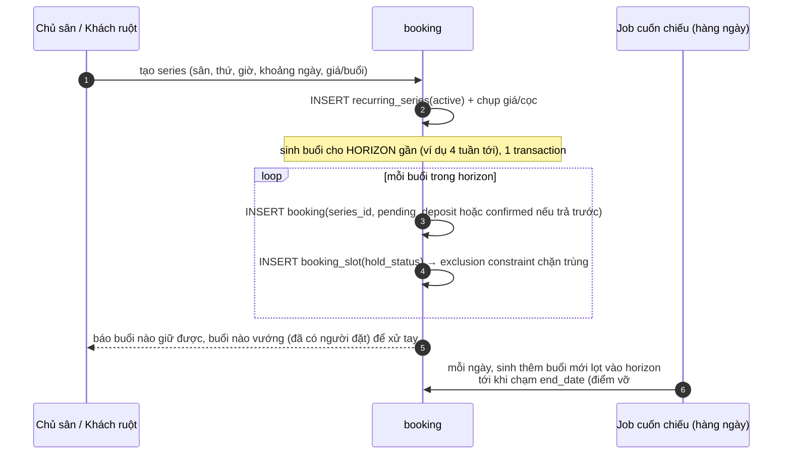

# 07 — Luồng dữ liệu

Bốn luồng cốt lõi. Ràng buộc nền tảng: cọc đi qua **VietQR chuyển khoản** — tiền vào ngay, không có authorize/capture, đối soát bất đồng bộ. Vì tiền vào là thật, **giữ chỗ chỉ chắc chắn sau khi đối soát khớp.**

---

## (a) Đặt sân → giữ tạm → cọc VietQR → đối soát → xác nhận / hết hạn

```mermaid
sequenceDiagram
    autonumber
    participant K as Người chơi (Zalo)
    participant API as booking
    participant PAY as payment
    participant BANK as Casso/SePay
    participant SW as Job hết hạn (60s)

    K->>API: chọn sân + khung giờ
    Note over API: 1 transaction
    API->>API: tính giá từ pricing_rule (server-side, snapshot vào booking_slot)
    API->>API: INSERT booking(pending_deposit, hold_expires_at = now()+10')
    API->>API: INSERT booking_slot(court_id, start, end, hold_status='holding')
    Note over API: exclusion constraint → trùng giờ sân = 23P01 → 409 "Sân vừa có người giữ"
    API->>PAY: INSERT payment(awaiting, memo_ref = booking.code)
    API-->>K: hiện QR VietQR (số tiền cọc + nội dung = booking.code)
    K->>BANK: chuyển khoản qua app ngân hàng
    BANK->>PAY: webhook giao dịch (bank_txn_id, amount, memo)
    PAY->>PAY: INSERT bank_txn_inbox (UNIQUE bank_txn_id; trùng → bỏ qua)
    PAY->>PAY: khớp memo→booking.code + amount
    Note over PAY,API: transaction đối soát — 3 nhánh
    alt booking pending_deposit còn hạn
        PAY->>API: confirmDeposit() → booking=confirmed,<br/>slot committed, payment=matched; outbox('booking.confirmed')
    else hết hạn NHƯNG sân vẫn trống (giữ lại được)
        PAY->>API: GRACE — giữ lại + confirmed (khách đã trả tiền, sân còn)
    else sân đã bị người khác giữ (thua race — hiếm)
        PAY->>PAY: payment=orphaned; INSERT refund(race_lost, requested)
        PAY->>API: outbox → báo khách + chủ sân hoàn cọc. KHÔNG nuốt tiền im lặng.
    end
    SW->>API: booking pending quá hạn → expired, slot released<br/>(exclusion tự "thả" giờ nhờ predicate hold_status)
```

**Ba bất biến:** (i) mọi đổi trạng thái booking cùng 1 transaction; (ii) đối soát idempotent bằng `UNIQUE(bank_txn_id)`, không bằng if-check; (iii) đặt hộ khách vãng lai đi nhánh `payment_mode='cash'` — bỏ qua bước QR, chủ sân đánh dấu đã thu tiền mặt.

---

## (b) Đặt cố định hàng tuần → sinh buổi → giữ cả loạt



- **Giá & cọc chụp vào series lúc tạo** — đổi bảng giá sau không ảnh hưởng series đang chạy.
- **Hủy một buổi:** cancel đúng `booking` đó (`series_id` giữ nguyên), slot released; series vẫn `active`, các buổi khác không đổi.
- **Vướng lịch khi sinh:** nếu một buổi trùng giờ sân đã có người đặt → exclusion constraint chặn, buổi đó không sinh được → báo chủ sân xử tay (đổi sân/giờ), không làm hỏng cả series.

---

## (c) Bom sân, hủy & hoàn cọc

```mermaid
sequenceDiagram
    autonumber
    participant A as Khách / Chủ sân
    participant BK as booking
    participant RF as refund

    alt Hủy trước giờ
        A->>BK: yêu cầu hủy (link Zalo hoặc chủ sân)
        BK->>BK: tính hoàn theo cancel_policy_SNAPSHOT<br/>(hủy sớm → hoàn cọc; hủy muộn → giữ cọc)
        BK->>BK: status=cancelled, slot released (1 transaction)
        BK->>RF: nếu hoàn → INSERT refund(requested) → chủ sân CK trả, đánh dấu done
    else Bom sân (không tới, không báo)
        BK->>BK: chủ sân đánh dấu no_show → cọc giữ theo chính sách<br/>(đánh dấu khách hay bom — cảnh báo lần sau, Phase 2)
    end
```

Refund là **ledger riêng** trỏ payment; `payment.amount` không bao giờ bị sửa. Ở VN cọc qua chuyển khoản nên hoàn cọc = chủ sân chuyển khoản trả tay (`method='manual_bank'`), dashboard hiện như TODO có đếm tuổi.

---

## (d) Nhắc lịch qua Zalo

```
Laravel event BookingConfirmed  → queued listener (afterCommit, Horizon)
  → gửi Zalo ZNS "Đã giữ sân X, HH:MM ngày DD"
Lịch nhắc (SendBookingReminders — Scheduler quét booking confirmed sắp tới, dùng cột reminded_at):
  → trước 1 ngày: ZNS nhắc
  → trước 2 tiếng: ZNS nhắc lần cuối (giảm bom hiệu quả nhất)
```

Phase 1 gửi bất đồng bộ bằng **Laravel Notification `ShouldQueue` + queued listener `afterCommit`** (Horizon, retry riêng) — gửi *sau khi transaction commit*, lỗi gửi ZNS không bao giờ kéo theo lỗi đặt sân. Mỗi lần gửi HTTP chỉ dùng `zalo_oa_configs` của đúng tenant: OA đang bật, token chưa hết hạn và map ID đã duyệt cho tên logic `booking_confirmed`, `reminder_1day` hoặc `reminder_2h`. Thiếu/tắt/chưa đủ config chỉ ghi `notification_messages` là failed để cấu hình xong redrive; lỗi mạng, 429 và 5xx retry tối đa 3 lần với backoff rồi giữ failure record. `ZALO_DRIVER=log` là fallback local chỉ ghi log/ledger, không cần credential. Email là kênh dự phòng khi khách chưa follow Zalo OA. (Bảng `event_outbox` chỉ cần ở **Phase 2** khi làm webhook ra ngoài *đảm bảo* cho agency — xem [`09-kien-truc-mo-rong.md`](09-kien-truc-mo-rong.md).)

---

## Tính khả dụng (availability) — compute-on-read

Khách chọn ngày+giờ → với mỗi sân: lấy `opening_rules` (giờ địa phương, lọc theo ngày) → trừ `blackouts` → trừ `booking_slots` đang `holding/committed` của sân đó → sân nào còn trống thì hiện + tính giá từ `pricing_rules`. Cache 30–60s. **Correctness do exclusion constraint đảm bảo lúc GHI; phần đọc chỉ cần gần đúng.** Không materialize lưới slot ([`11-diem-vo.md`](11-diem-vo.md) #4).
